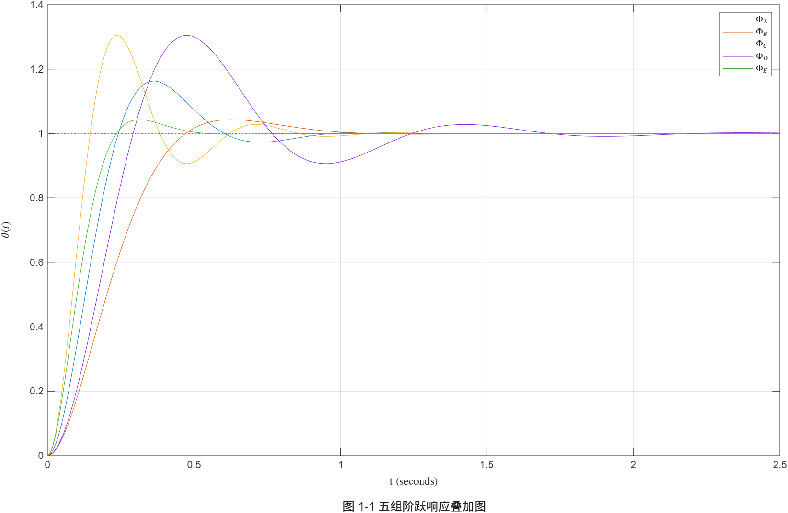

# 自动控制原理 C 实践项目

## 1 时域与稳态分析

使用开环传递函数 $L(s)$ 确定闭环传递函数 $\Phi(s)$ ：

$$
\begin{alignat*}{2}
  \because   &\quad& C(s)    &= K_p ,\quad G(s) = \frac{K}{s(Ts+1)} \\[8pt]
  \therefore &\quad& L(s)    &= C(s)G(s) = \frac{K_p K}{s(Ts+1)}    \\[8pt]
  \therefore &\quad& \Phi(s) &= \frac{L(s)}{1 + L(s)}               \\[8pt]
             &     &         &= \frac{K_p K}{Ts^2 + s + K_p K}      \\[8pt]
             &     &         &= \frac{\frac{K_p K}{T}}{s^2 + \frac{1}{T}s + \frac{K_p K}{T}}
\end{alignat*}
$$

### 1.1

此时固定 $K_p = 1$，将 $K$ 和 $T$ 的各组数值代入计算，得出各组闭环传递函数 $\Phi(s)$ ：

$$
\begin{alignat*}{1}    
\Phi_{A}(s)  &= \frac{100}{s^2+10s+100} \\[8pt]
\Phi_{B}(s)  &= \frac{50}{s^2+10s+50}   \\[8pt]
\Phi_{C}(s)  &= \frac{200}{s^2+10s+200} \\[8pt]
\Phi_{D}(s)  &= \frac{50}{s^2+5s+50}    \\[8pt]
\Phi_{E}(s)  &= \frac{200}{s^2+20s+200} \\[8pt]
\end{alignat*}
$$

依据上述闭环传递函数 $\Phi(s)$ 可以简单的得到从 A 到 E 各组的闭环传递函数极点：

$$
\begin{alignat*}{2}
\Phi_{A}(s) &:{}& -5           & \pm 5 \sqrt{3} j           \\[8pt]
\Phi_{B}(s) &:{}& -5           & \pm 5 j                    \\[8pt]
\Phi_{C}(s) &:{}& -5           & \pm 5 \sqrt{7} j           \\[8pt]
\Phi_{D}(s) &:{}& -\frac{5}{2} & \pm \frac{5}{2} \sqrt{7} j \\[8pt]
\Phi_{E}(s) &:{}& -10          & \pm 10 j
\end{alignat*}
$$

在 Matlab 中绘制单位阶跃响应叠加图，不必直接计算开环传递函数 $L(s)$ 和闭环传递函数 $\Phi(s)$，这里使用 `tf()` 创建传递函数模型对应 $L(s)$，使用 `feedback()` 添加单位负反馈，组成闭环传递函数 $\Phi(s)$：

### 1.2

