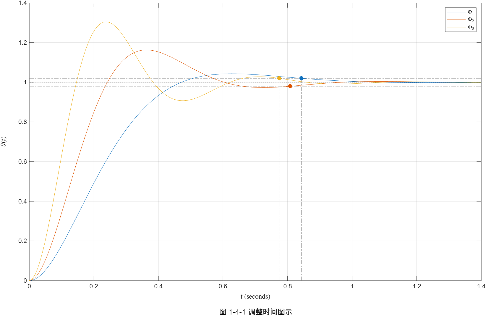

# 自动控制原理 C 实践项目

## 1 时域与稳态分析

使用开环传递函数 $L(s)$ 确定闭环传递函数 $\Phi(s)$ ：

$$
\begin{alignat}{2}
  \because   &\quad& C(s)    &= K_p ,\quad G(s) = \frac{K}{s(Ts+1)} \\[8pt]
  \therefore &\quad& L(s)    &= C(s)G(s) = \frac{K_p K}{s(Ts+1)}    \\[8pt]
  \therefore &\quad& \Phi(s) &= \frac{L(s)}{1 + L(s)}               \\[8pt]
             &     &         &= \frac{K_p K}{Ts^2 + s + K_p K}      \\[8pt]
             &     &         &= \frac{\frac{K_p K}{T}}{s^2 + \frac{1}{T}s + \frac{K_p K}{T}}
\end{alignat}
$$

### 1.1 闭环传递函数与极点，五组阶跃响应叠加图

此时固定 $K_p = 1$，将 $K$ 和 $T$ 的各组数值代入计算，得出各组闭环传递函数 $\Phi(s)$ ：

$$
\begin{alignat}{1}    
\Phi_{A}(s)  &= \frac{100}{s^2+10s+100} \\[8pt]
\Phi_{B}(s)  &= \frac{50}{s^2+10s+50}   \\[8pt]
\Phi_{C}(s)  &= \frac{200}{s^2+10s+200} \\[8pt]
\Phi_{D}(s)  &= \frac{50}{s^2+5s+50}    \\[8pt]
\Phi_{E}(s)  &= \frac{200}{s^2+20s+200} \\[8pt]
\end{alignat}
$$

依据上述闭环传递函数 $\Phi(s)$ 可以简单的得到从 A 到 E 各组的闭环传递函数极点：

$$
\begin{alignat}{2}
\Phi_{A}(s) &:{}& -5           & \pm 5 \sqrt{3} j           \\[8pt]
\Phi_{B}(s) &:{}& -5           & \pm 5 j                    \\[8pt]
\Phi_{C}(s) &:{}& -5           & \pm 5 \sqrt{7} j           \\[8pt]
\Phi_{D}(s) &:{}& -\frac{5}{2} & \pm \frac{5}{2} \sqrt{7} j \\[8pt]
\Phi_{E}(s) &:{}& -10          & \pm 10 j
\end{alignat}
$$

在 Matlab 中绘制单位阶跃响应叠加图，不必直接计算开环传递函数 $L(s)$ 和闭环传递函数 $\Phi(s)$，这里使用 `tf()` 创建传递函数模型对应 $L(s)$，使用 `feedback()` 添加单位负反馈，组成闭环传递函数 $\Phi(s)$：（具体见 `task1_1.m:19:`）

### 1.2 阻尼比 $\xi$、自然频率 $\omega_{n}$、超调量 $M_p$ 与调节时间 $t_s$

当保持 A 组的 $K$ 和 $T$ 时，三种 $K_p$ 有：

$$
\begin{alignat}{2}    
\Phi_{1}(s) &\mid _{K_p = 0.5} &&= \frac{50}{s^2+10s+50}   \\[8pt]
\Phi_{2}(s) &\mid _{K_p = 1}   &&= \frac{100}{s^2+10s+100} \\[8pt]
\Phi_{3}(s) &\mid _{K_p = 2}   &&= \frac{200}{s^2+10s+200}
\end{alignat}
$$

上式均为首一标准型，简单可知 $\xi$ 和 $\omega_{n}$，由下列公式可以计算 $M_p$ 和 $t_s$（使用 2\% 误差带）：

$$  
\begin{alignat}{1}   
M_p &= e^{-\frac{\xi\pi}{\sqrt{1-\xi^2}}} \\[8pt]
t_s &= \frac{-\ln{0.02}-\ln{\sqrt{1-\xi^2}}}{\omega_{n}\xi} \approx \frac{4}{\omega_{n}\xi}
\end{alignat}
$$

| $\Phi(s)$     | $K_p$ | $\xi$   | $\omega_{n}$ | $M_p$      | $t_s$   |
| ------------- | ----- | ------- | ------------ | ---------- | ------- |
| $\Phi_{1}(s)$ | $0.5$ | $0.707$ | $7.071$      | $4.321\%$  | $0.852$ |
| $\Phi_{2}(s)$ | $1$   | $0.5$   | $10$         | $16.303\%$ | $0.811$ |
| $\Phi_{3}(s)$ | $2$   | $0.354$ | $14.142$     | $30.501\%$ | $0.796$ |

Table: 表 1-2-1 闭环传递函数理论性能指标表

使用 Matlab 的 `stepinfo()` 也可得 $M_p$ 和 $t_s$：（具体见 `task1_1.m:47:`）

| $\Phi(s)$     | $K_p$ | ${M_p}^{*}$ | ${t_s}^{*}$ |
| ------------- | ----- | ----------- | ----------- |
| $\Phi_{1}(s)$ | $0.5$ | $4.321\%$   | $0.843$     |
| $\Phi_{2}(s)$ | $1$   | $16.293\%$  | $0.808$     |
| $\Phi_{3}(s)$ | $2$   | $30.489\%$  | $0.774$     |

Table: 表 1-2-2 闭环传递函数实验性能指标表

### 1.3 单位阶跃稳态误差 $e_{ss}$

由开环传递函数 $L(s)$ 可以判断该系统为 I 型系统，所以理论上该系统对单位阶跃信号的稳态误差为 0.

$$
L(s) = C(s)G(s) = \frac{K_p K}{s(Ts+1)}
$$

使用 Matlab 的 `[y, t] = step(PHI)` 再通过 `y(end)` 取得终值，将其与 1 比较即可获得稳态误差：当 $K_p$ 依次为 0.5、1 和 2 时，$e_{ss}$ 为 0.001858、-0.003975 和 0.003208。（具体见 `task1_1.m:63:`）

### 1.4 理论估计和软件测量结果的差异解释

在本任务的 1.2 和 1.3 篇章中有出现理论值和 Matlab 实验值存在误差的情况。

#### 1.4.1 超调量 $M_p$ 和调整时间 $t_s$ 差异分析

| $\Phi(s)$     | $K_p$ | $\xi$   | $\omega_{n}$ | $M_p$      | ${M_p}^{*}$ | $t_s$   | ${t_s}^{*}$ |
| ------------- | ----- | ------- | ------------ | ---------- | ----------- | ------- | ----------- |
| $\Phi_{1}(s)$ | $0.5$ | $0.707$ | $7.071$      | $4.321\%$  | $4.321\%$   | $0.852$ | $0.843$     |
| $\Phi_{2}(s)$ | $1$   | $0.5$   | $10$         | $16.303\%$ | $16.293\%$  | $0.811$ | $0.808$     |
| $\Phi_{3}(s)$ | $2$   | $0.354$ | $14.142$     | $30.501\%$ | $30.489\%$  | $0.796$ | $0.774$     |

Table: 表 1-4-1 闭环传递函数性能指标汇总表

从总体上来看，不论是超调量 $M_p$ 和 ${M_p}^{*}$，抑或是调整时间 $t_s$ 和 ${t_s}^{*}$，在对应指标组里变化趋势均是相同的，没有出现理论值变化趋势和实验值变化趋势不同；它们各自在关于 $\xi$ 和 $\omega_{n}$ 的变化关系上也均是和理论相呼应的。
从数值上来看，$\Phi_{2}(s)$ 的 $\Phi_{3}(s)$ 在超调量的千分位上出现不同，调整时间则是均出现了百分位上的不同：
1. 从数值计算的误差角度可以理解 Matlab 存在一定的舍入误差这可能导致了超调量的千分位上的误差.
2. 对调整时间而言，由于其误差出现在百分位，刨去舍入误差的影响因素有必要考虑其他的影响因素。从下图可见 Matlab 对于调整时间的计算符合定义；书本上和课程中使用的调整时间计算公式依赖调整时间的包络线，因为这样会进一步保证响应曲线不会超出 2% 误差带，这种计算方法导致结果偏大。故而可见从百分位上 $t_s$ 稍大于 ${t_s}^{*}$，而 Matlab 的计算方法更加精确。综上，由于方法误差导致了调整时间百分位上的误差。

#### 1.4.2 单位阶跃稳态误差 $e_{ss}$ 差异分析

理论上 $e_{ss}$ 应该都是 0，然而 Matlab 依次计算得出 0.001858、-0.003975 和 0.003208。此处误差较大，是因为使用 `y(end)` 取得终值受限于计算的程度，当计算的时长更长则可以获得更小的实验稳态误差值。
这里可以更换一种思路：通过获得开环增益直接计算（使用 Matlab 直接模拟理论计算方法），于是可以得到均是 0 的稳态误差。（具体见 `task1_1.m:98:`）